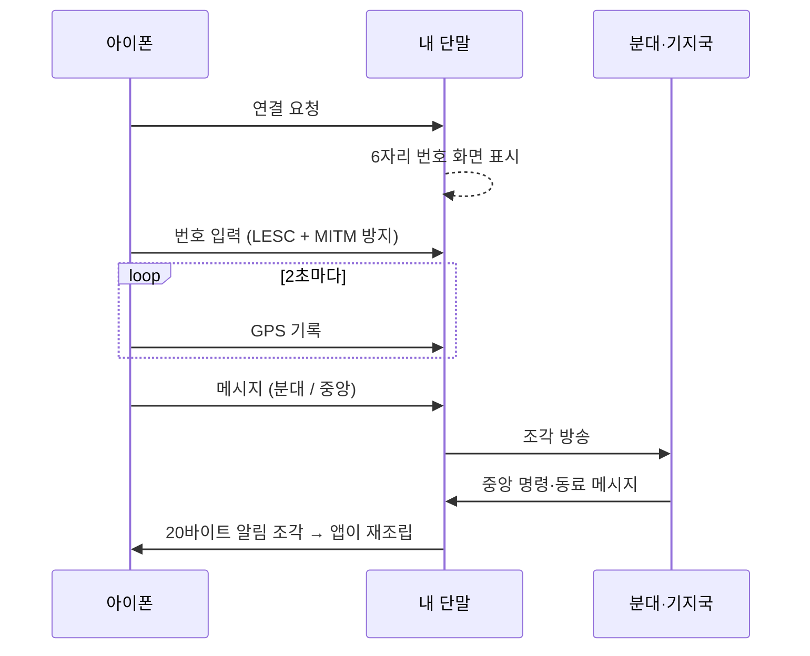

# 현맥 (玄脈) · 병사용 아이폰 앱

**단말이 주인공, 폰은 눈과 펜.** 폰은 위치를 알려 주고 긴 글을 쓰는 데만 쓴다. 방송은 단말이 한다.

D4D × EDTH SEOUL 2026 출품작 · [firmware](https://github.com/hyeonmaek/firmware) · [app](https://github.com/hyeonmaek/app) · [web](https://github.com/hyeonmaek/web)

## 문제

| 문제 | 이유 |
|---|---|
| 단말에는 GPS가 없다 | 소형·저전력 단말에 GPS를 넣으면 크기·전력이 커진다 |
| 아이폰은 분대 방송에 끼지 못한다 | iOS는 제조사 데이터 BLE 광고를 허용하지 않는다 |
| 버튼 4개로는 문장을 못 쓴다 | 지휘소에 상황을 글로 보고할 수단이 필요 |
| 폰과 단말 사이 연결도 도청·가로채기 대상이다 | 근거리라도 무선은 무선 |

## 해법

| 문제 | 기술 | 구현 |
|---|---|---|
| 위치 | **GPS 주입** | 2초마다 위경도를 단말에 기록 → 단말이 보고 순간 암호 방송에 실음 |
| 방송 불가 | **자기 단말 경유 1:1 GATT** | 폰은 자기 단말과만 연결하고, 분대 방송은 단말이 대신 한다 |
| 문장 보고 | **분대 / 중앙 선택 전송** | "중앙"을 고르면 단말 → 기지국 → 지휘소까지 올라가 보고로 기록 |
| 연결 보안 | **LESC 6자리 번호 페어링** | 단말 화면의 번호를 입력해야 연결. 재연결도 매번. 틀리면 즉시 안내 |

## 동작

## 핵심 기술

- **SwiftUI + CoreBluetooth**: 서비스 1개, 특성 3개(GPS 쓰기, 메시지 쓰기, 상태 알림). 모든 특성은 암호화·MITM 보호 연결에서만 접근 가능
- **조각 재조립**: 단말이 받은 메시지를 `[종류][보낸이][번호][조각/조각수][UTF-16 ×7]`로 나눠 알림 → (보낸이, 번호) 키로 모아 완성 시 목록에 추가, 중복 제거
- **바이트 약속표 단일화**: `BLEProtocol.swift` 한 파일에 UUID·바이트 배치를 모아 펌웨어와 1바이트 단위로 일치
- **상태 표시는 실제 연결 기준**: 알림 구독까지 끝나야(=페어링 성공) "연결됨"

## 화면

| 탭 | 내용 |
|---|---|
| 연결 | 주변 단말 목록(신호 세기) → 선택 → 번호 입력. 탐색·연결·잠금 애니메이션, 실패 시 흔들림 + 원인 안내 |
| 메시지 | 받은 메시지(중앙·동료)와 보낸 메시지. 오른쪽 위 작성 버튼 → 시트에서 분대/중앙 선택 |
| 지도 | 위성 지도 전체 화면, 내 위치 |

## 빌드

Xcode 15+, iOS 17+. `ios/SquadLink/SquadLink.xcodeproj` → Signing에서 자기 Team 선택 → 아이폰 연결 후 실행.

`web/squadphone.html`: 같은 기능의 크롬 Web Bluetooth 판(보조).
